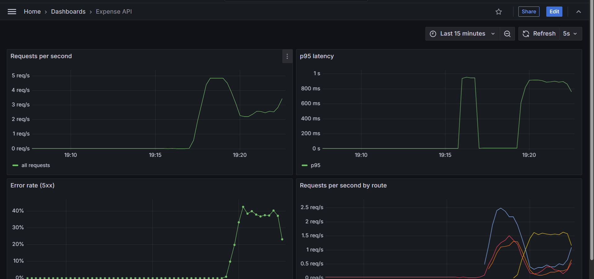

# Expense Reimbursement API

A backend service where employees submit expenses and their managers approve or reject them. It is built as three connected pieces: the application, an automated test suite around it, and a monitoring setup that watches it.

I built it to practice backend engineering habits: role-based access, database transactions, audit logging, isolated testing, CI and observability.

## What's inside

| Part | What it does | Where |
|---|---|---|
| Expense API | Employees, expenses, approval workflow, audit log, JWT login | `app/` |
| Test suite | Pytest tests, isolated test database, coverage above 95%, GitHub Actions CI | `tests/`, `.github/workflows/` |
| Monitoring | JSON logs, Prometheus metrics, Grafana dashboard, alert rule, simulated incident | `monitoring/`, `scripts/traffic.py`, `incident/` |

**Stack:** Python 3.12, FastAPI, PostgreSQL, SQLAlchemy, Pydantic, PyJWT, bcrypt, Pytest, Docker Compose, GitHub Actions, Prometheus, Grafana.

## What it does

- Employees log in and submit expenses (amount, category, description).
- Managers see their team's expenses and approve or reject them. A rejection needs a comment.
- Rules enforced by the API:
  - employees cannot approve anything
  - managers cannot decide their own expenses
  - managers can only decide their direct reports' expenses
  - an expense can only be decided once
- Every submission and decision is written to an append-only audit log, in the same database transaction as the change.

## Quick start

You need Docker Desktop. Run these from the project folder.

```
docker compose up --build -d
```

This starts PostgreSQL, the API, Prometheus and Grafana. Then create the first manager. The API needs a manager before it can create any other account:

```
docker compose exec api python -m scripts.seed_manager
```

Open these:

| What | Address |
|---|---|
| API docs (try the endpoints here) | http://127.0.0.1:8000/docs |
| Health and readiness | http://127.0.0.1:8000/health and http://127.0.0.1:8000/ready |
| Prometheus | http://localhost:9090 |
| Grafana, dashboard "Expense API" | http://localhost:3000 (login `admin` / `admin`, local development only) |

In `/docs`, click **Authorize** and log in with the manager's email and password. Use **POST /employees** to create employees and set their `manager_id`. Then log in as an employee to submit expenses, and as the manager to decide them.

## Endpoints

| Method | Path | Who can use it |
|---|---|---|
| POST | `/auth/login` | anyone |
| GET | `/auth/me` | logged-in users |
| POST | `/employees` | managers |
| GET | `/employees` | managers (their own team) |
| POST | `/expenses` | logged-in users |
| GET | `/expenses` | logged-in users (their own, with status, category and paging filters) |
| GET | `/expenses/team` | managers |
| GET | `/expenses/{id}` | the owner, or the owner's manager |
| GET | `/expenses/{id}/history` | the owner, or the owner's manager |
| POST | `/expenses/{id}/decision` | the owner's manager |
| GET | `/health`, `/ready`, `/metrics` | open |

## Running the tests

The tests use their own database, so they never touch real data. They refuse to run if the database URL doesn't contain "test".

```
docker compose up -d db
docker compose exec db psql -U expense_user -d expense_db -c "CREATE DATABASE expense_test_db;"
python -m venv venv
venv\Scripts\activate
python -m pip install -r requirements.txt
python -m pytest --cov=app --cov-report=term-missing -q
```

GitHub Actions runs the same suite on every push, with a Postgres service container, and fails the build if coverage drops below 80%.

## How the tests work

- **Isolation:** each test runs inside a database transaction that is rolled back afterwards. The session uses a savepoint, so the application's own `commit()` does not make data permanent. Two tests prove that nothing leaks between tests, whatever the run order.
- **Fixtures:** `conftest.py` provides the test session, an API client that uses it, and ready-made manager and employee users (two teams, so cross-team access can be tested). `factories.py` has small helpers for test data and tokens.
- **Negative cases:** invalid inputs are tested with `parametrize`. Security rules (who can see or decide what) are tested explicitly, and the refusal tests also check that nothing changed in the database.
- **What the tests caught:** the auth tests found a real bug. Invalid tokens returned a 500 instead of a 401, because the error headers were built as a set instead of a dictionary.

## Monitoring

- **Logs:** one JSON line per request with request ID, method, path, status, latency, user id and role. Request bodies and headers are never logged, and a test checks that passwords and tokens do not appear in the logs.
- **Metrics:** request counts by method, route and status, plus a latency histogram. Routes are labeled with their template (`/expenses/{expense_id}`) instead of the raw URL, and unknown paths share one `unmatched` label, so the number of metric series stays bounded.
- **Dashboard:** requests per second, p95 latency, error rate, and requests by route.
- **Alert:** `HighErrorRate` fires when more than 5% of requests return a 5xx error for 1 minute.



### Simulated incident

`scripts/traffic.py` sends scripted traffic in three phases (baseline, fault, recovery) with a fixed random seed, so the run is repeatable. The fault phase calls a debug endpoint that returns errors and slow responses on purpose.

| Phase | Duration | Requests | Result |
|---|---|---|---|
| Baseline | 2 min | 578 | all 200 |
| Fault | 3 min | 428 | 178 returned 500 (41.6%) |
| Recovery | 2 min | 579 | all 200 |

During the fault, p95 latency rose to about 0.9 s. `HighErrorRate` was first Pending at 19:19:30 and first Firing at 19:20:26, 1 min 22 s after the fault began. Full timeline, impact and notes are in [`incident/incident-report.md`](incident/incident-report.md).

The fault endpoint (`/debug/fault`) is only registered when `FAULT_INJECTION_ENABLED=true`. It is off by default, and when it is off the route does not exist (404).

## Design decisions

- **Money is stored as `Numeric(12, 2)`,** not a float, to avoid rounding errors.
- **Approvals use one conditional `UPDATE ... WHERE status = 'pending'`.** If two requests try to decide the same expense, the database lets one win; the other changes zero rows and gets a 409. The audit row is written in the same transaction, so the log can never disagree with the expense.
- **Someone else's expense returns 404, not 403,** so the API does not reveal that it exists.
- **Login gives the same error for a wrong password and an unknown email,** so it can't be used to discover which emails are registered.
- **The token holds only the user id.** The role is read from the database on every request, so a role change takes effect immediately.
- **`/health` does not touch the database; `/ready` does.** A database outage shows up as "not ready" while the process itself stays healthy.
- **No separate approvals table.** The audit log is the approval history, so there is one source of truth.

## Limitations

This is a learning project, not a production system.

- Tables are created with `create_all`. There are no migrations (Alembic would be the next step).
- One access token with a 30-minute expiry. No refresh tokens, logout list, rate limiting or password reset.
- There is no endpoint to change an employee's manager.
- The development passwords in `docker-compose.yml` and the default `SECRET_KEY` are for local use only. A real deployment would load secrets from the environment.
- `/metrics` has no authentication.
- Prometheus data is not kept when its container is recreated.
- The tests prove that a second decision is refused. They do not simulate two requests at the exact same instant; that guarantee comes from the single atomic `UPDATE`.
- Not deployed anywhere. It runs locally with Docker Compose.

## Project layout

```
app/            FastAPI application: routers, models, schemas, auth, middleware, metrics
tests/          Pytest suite
scripts/        seed_manager.py (first manager) and traffic.py (incident run)
monitoring/     Prometheus and Grafana configuration
incident/       Timeline, screenshots and report from the simulated incident
.github/        CI workflow
```